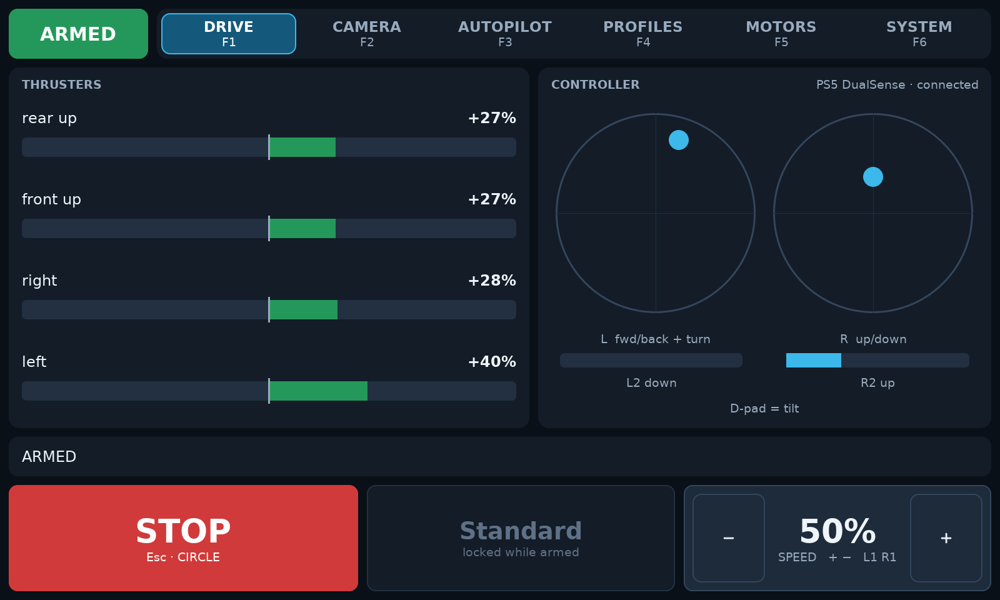
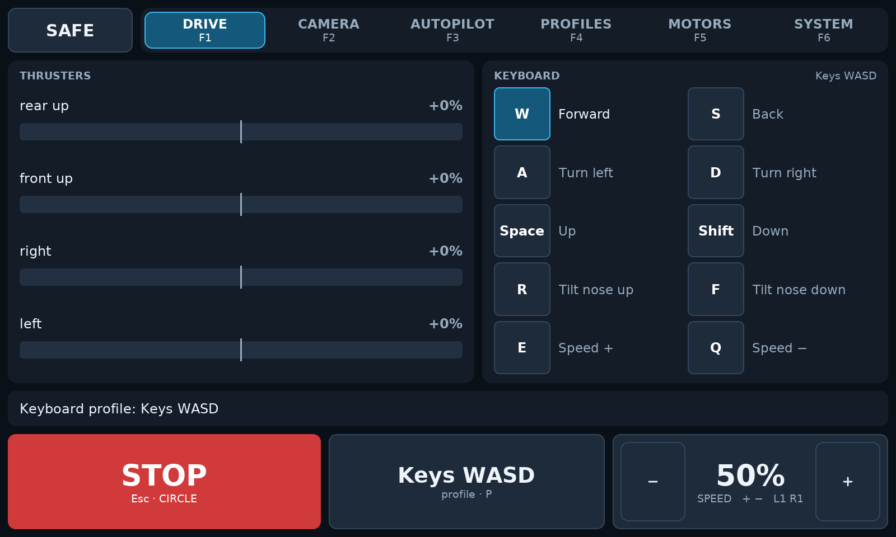
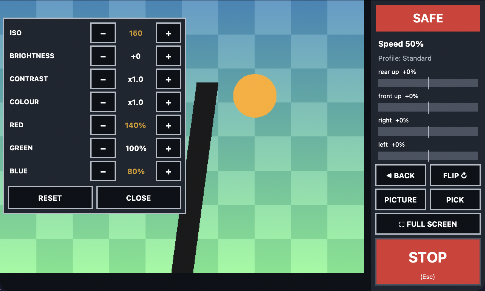
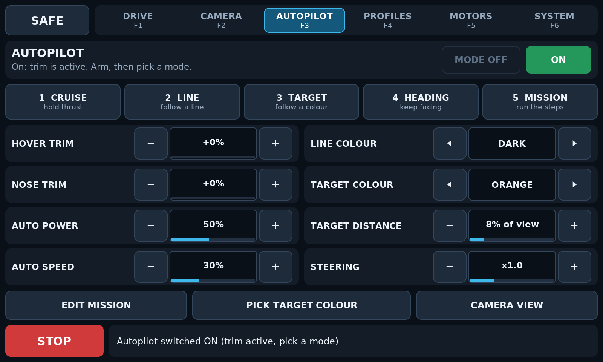
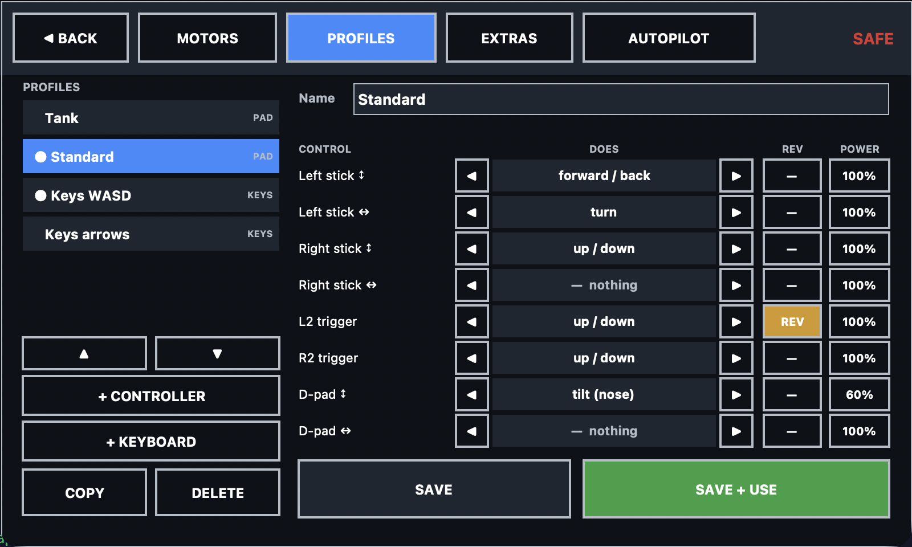
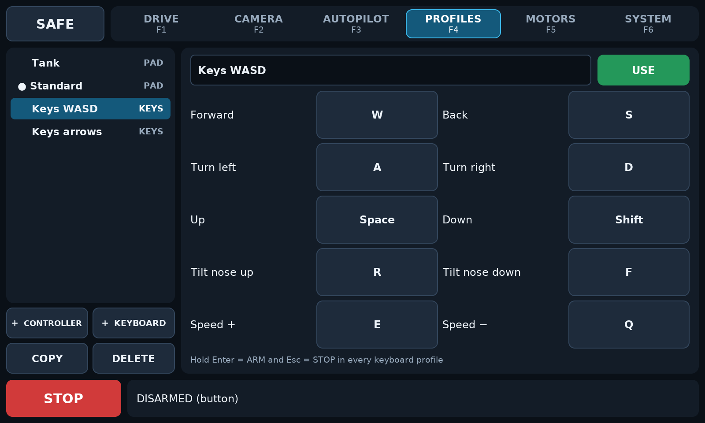
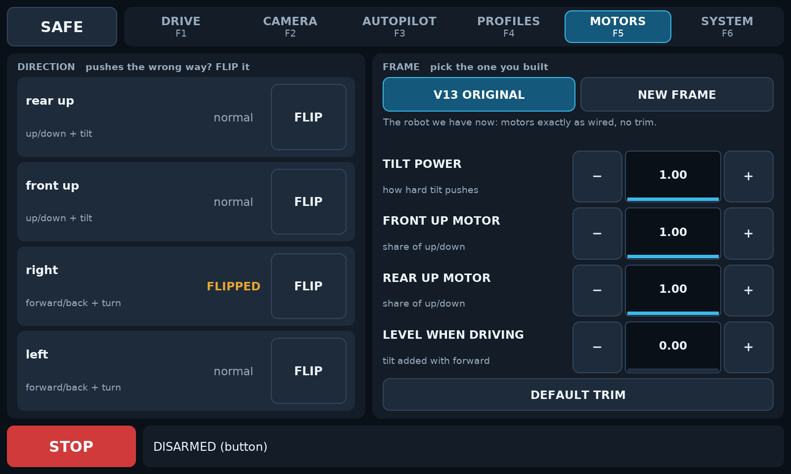
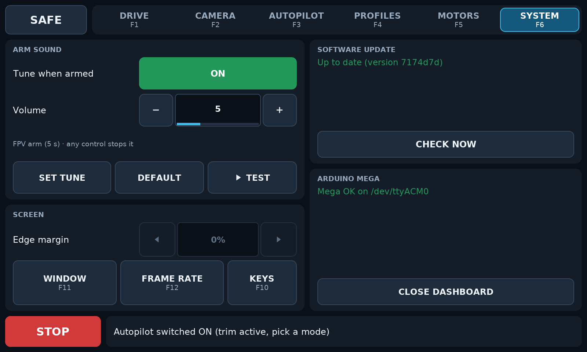
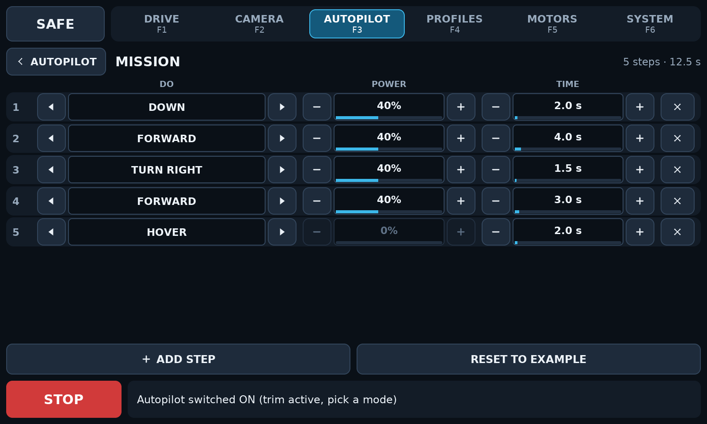
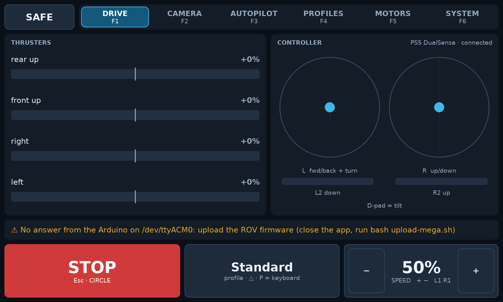

# ROV Backup: laptop + Arduino Mega

A second, independent way to drive the ROV if the Raspberry Pi fails.
The **laptop (EndeavourOS)** reads the PS5/PS4 controller and runs the same dashboard, drive profiles and
camera page as the Pi. It sends motor commands over **USB** to an **Arduino Mega 2560**, and the Mega drives the
same 4 BTS7960 boards.

```
PS5 controller --Bluetooth/USB--> Laptop (ROV Backup app) --USB--> Arduino Mega --> 4x BTS7960 --> thrusters
```

## Screenshots
The same dashboard as on the Pi, with simulated ROV data; the camera picture is a test pattern:

| DRIVE with a controller profile | DRIVE with a keyboard profile |
|---|---|
|  |  |
| **CAMERA** + PICTURE (ISO, RGB) | **AUTOPILOT** |
|  |  |
| **PROFILES**: controller profile | **PROFILES**: keyboard profile |
|  |  |
| **MOTORS** (direction, frame trim) | **SYSTEM** (sound, update, screen, Arduino Mega) |
|  |  |
| Mission editor | No answer from the Mega |
|  |  |

## Files
| File | What it is |
|---|---|
| `rov_mega/rov_mega.ino` | Mega firmware (upload once) |
| `rov_gui.py` | **the app**: opens the window (code in `dashboard/`) and runs the motor program. Nothing else to start |
| `rov.py` | motor program (controller → motors), same as the Pi's but outputs to the Mega; the app starts and stops it |
| `config.toml` | Mega pins, motor jobs/flips (copied from the Pi) |
| `profiles.json` | drive profiles (copied from the Pi) |
| `designs.json` | your changes to the frame-design trims (made on the MOTORS page; not in the repo) |
| `tests/` | automatic tests: `python3 -m unittest discover tests` (no Mega or controller needed) |
| `setup.sh` | one-command install / update (see above) |
| `updater.py` | automatic updates from GitHub (used by the app) |
| `install.sh` · `upload-mega.sh` · `run.sh` | set up · flash the Mega · start |

## Wiring (Mega)

Move the BTS7960 **signal** wires from the Pi to the Mega. The battery/motor wires (B+, B−, M+, M−) stay the same.
**Never connect the boards to the Pi and the Mega at the same time.** Making a second set of jumper wires
lets you swap over in a minute.

| BTS7960 board | RPWM | LPWM |
|---|---|---|
| Motor 1 (rear up)  | pin 2  | pin 3  |
| Motor 2 (front up) | pin 5  | pin 6  |
| Motor 3 (right)    | pin 7  | pin 8  |
| Motor 4 (left)     | pin 11 | pin 12 |

- **R_EN + L_EN on all 4 boards → pin 22**, with a **10 kΩ resistor from pin 22 to GND**.
- **VCC on all 4 boards → Mega 5V.** **GND → Mega GND.**
- Leave R_IS / L_IS unconnected.
- The Mega is powered by the laptop's USB cable.

The Mega's built-in **"L" LED is on whenever the motors are enabled**.

## Install or update: one command
On the EndeavourOS laptop, connected to the internet (Wi-Fi is fine), open a terminal and run:
```bash
curl -fsSL https://raw.githubusercontent.com/codemastervy/underwater-rov-backup/main/setup.sh | bash
```
- **New laptop:** installs everything (Python libraries, Bluetooth, ffmpeg, arduino-cli), adds **ROV Backup** to the app
  menu, and uploads the firmware if the **Mega is plugged in**. Then **log out and back in once**.
- **Already installed:** downloads the latest version and keeps your `config.toml`, `profiles.json` and `camera.json`.
  If the Mega is plugged in and the firmware changed, it uploads the new firmware too.
- Close the ROV Backup app before running it. Nothing needs installing first, not even git.
- **After that you never need the command again:** the app checks GitHub for a new version when it opens and every
  30 minutes. When there is one, it shows **UPDATE READY**; click it, then **SYSTEM › UPDATE NOW** while SAFE.
  It downloads, installs and reopens itself. Settings are kept. If the update has new **Mega firmware**, the
  update panel tells you: close the app, plug in the Mega and run `bash ~/underwater-rov-backup/upload-mega.sh`.

Then pair the controller in the laptop's Bluetooth settings (PS5: hold **CREATE + PS**), or plug it in with a USB cable.

## Driving

**Printable controller card:** [docs/controller-card.pdf](docs/controller-card.pdf) (A4 landscape, one page) to stick on the case.
Open **ROV Backup** from the app menu (or `bash run.sh`). The controls are the same as on the Pi:

| Button | Action |
|---|---|
| OPTIONS | arm (sticks centred) |
| CIRCLE / CREATE / PS | disarm |
| Sticks / triggers / D-pad | depends on the profile in use (PROFILES page) |
| TRIANGLE | next controller profile (while SAFE) |
| SQUARE | camera page on/off |
| R1 / L1 | speed up/down |

**Profiles:** exactly one is in use, and its type decides what drives: a **controller profile** (PAD) or a **keyboard
profile** (KEYS). Only the device that drives can arm; STOP works from everything at all times. TRIANGLE = next
controller profile, **P** = next keyboard profile, or pick one from the PROFILE button on DRIVE (only while SAFE).
**PROFILES (F4)** makes, copies, renames, deletes and edits them; **USE** puts one in use. Changes are saved at once.

**Keyboard profiles** (built in: **Keys WASD** and **Keys arrows**): W/S forward/back, A/D turn, Space up, Shift down,
R/F tilt, E/Q speed, **hold Enter = ARM**, **Esc = STOP**. **A key is full power at once**: no ramp, and keyboard
profiles start at 100 % speed (E/Q lower it; `keyboard_speed_level` and `keyboard_ramp_per_second` in `config.toml`). Keys drive on DRIVE and CAMERA. If the window closes, freezes
or loses the keyboard for 0.5 s, **the motors disarm**. The old KEYBOARD DRIVE switch is gone: if it was on, the update
puts a keyboard profile in use.

**Dashboard:** everything works with the mouse alone, and with the keyboard alone (arming is not on the mouse on purpose).

| Key | |
|---|---|
| **Esc** | STOP, always. If it was already SAFE it also goes back |
| F1-F6 | DRIVE, CAMERA, AUTOPILOT, PROFILES, MOTORS, SYSTEM (F2 again: full-screen video) |
| arrows, Tab / Enter / Backspace | move the focus ring / use / back |
| + − on a value or list | change it (arrows only ever move) |
| P, + −, C, 1-5, 0 | on DRIVE and CAMERA: keyboard profile, speed, camera, autopilot mode, mode off |
| Space | on DRIVE and CAMERA: STOP, unless the keyboard profile uses it |
| F10, F11, F12 | list of keys, full screen / window, frame rate |

With a keyboard profile, keys drive on DRIVE and CAMERA until you press **Tab**; then they work the screen until
**Backspace**. On the other pages they never drive.

It opens in a window you can resize. `bash run.sh --fullscreen` for full screen, `--size 1600x960` for another window
size, `--fps 60` to limit the frame rate (saves battery), `--page camera` to start on another page. **`--dry-run`** tries it
without a Mega. It is one app: closing the window stops the motor program too, and a second copy refuses to open.

**Arm sound:** when armed, the motors play **an FPV-drone style arming sound (5 s)** (no
speaker: a tiny audio-frequency PWM makes the motors whistle). **Touch any control and it stops at once** so you can
drive. **SYSTEM (F6)**: **SET TUNE** takes any RTTTL ringtone text (saved in `tune.txt`); **DEFAULT** goes back; on/off,
volume and TEST are there too.

**Autopilot (F3)** (the controller can't switch it on, OFF at every start-up): trim, CRUISE, LINE following, colour
TARGET following (pick the colour on the camera page with PICK), camera HEADING hold and timed MISSIONs.
Any stick/key movement or STOP takes over. Green status bar = working; flashing red **TAKE CONTROL NOW** = unsure
(it hovers, then switches off after 3 s). Same as the Pi version: see the Pi repo's README for details.

**Camera picture:** CAMERA › PICTURE adjusts **ISO** (100 = normal, up to 400 for dark water), brightness, contrast,
colour and **RED / GREEN / BLUE** on their own (water makes things blue-green: try more RED, less BLUE).
It changes live and is saved in `camera.json`. **FULL**: full-screen video; STOP and ARMED/SAFE stay at the sides.

**Camera:** plug the capture card into the laptop. It's picked automatically (the laptop's own webcam is skipped).
Wrong camera? Change it with the **− name +** box above STOP on the camera page (click the name for the whole list); the
choice is remembered (`camera.json`). (`device = "/dev/video2"` under `[camera]` in `config.toml` still forces one.)

**MOTORS (F5)** (only while SAFE): **FLIP** reverses a motor that pushes the wrong way. **FRAME** picks the frame on the
robot: **V13 ORIGINAL** (no trim: the default) or **NEW FRAME** (the pool-noodle frame in
[aquabots-rov-hull](https://github.com/codemastervy/aquabots-rov-hull)), and fine-tunes its trim in the pool (saved in
`designs.json`, kept on updates); **DEFAULT TRIM** puts it back. See the Pi repo's README (Frame designs).

## Safety
- Won't arm until the Mega has answered ("⚠ Arduino Mega not found" is shown otherwise).
- **The Mega stops all motors by itself if the laptop goes quiet for 0.3 s**: app closed, laptop crash,
  USB unplugged.
- The laptop disarms if the Mega stops answering, restarts or switches its motors off by itself, the controller disconnects, or its Bluetooth link goes quiet.
- After any of these you must arm again (OPTIONS, or hold Enter with a keyboard profile).

## Troubleshooting
- `rov.log` in the app's folder says what happened. Identify the motors: close the app, then `python3 rov.py --test`.
- "No permission for /dev/ttyACM0": you didn't log out/in after `install.sh`.
- "No answer from /dev/ttyACM0": the firmware isn't uploaded. Run `upload-mega.sh`.
- Controller not seen: `python3 rov.py --list` lists input devices.
- Motor wrong way: MOTORS (F5) > FLIP (saved in this laptop's `config.toml`, separate from the Pi).
