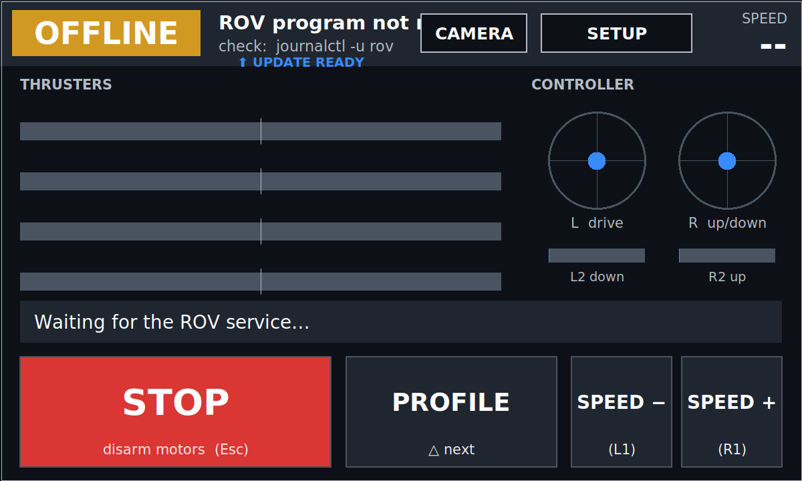
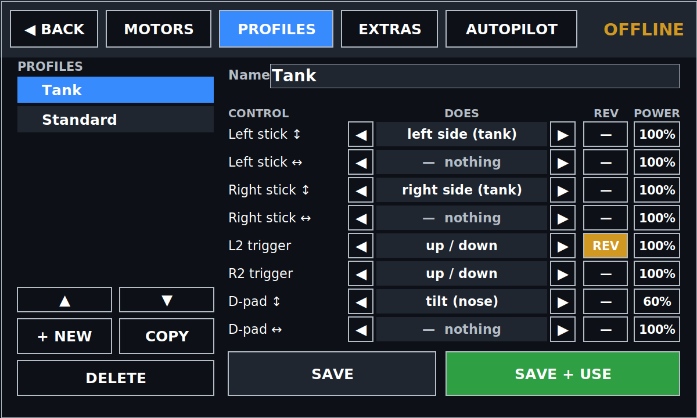
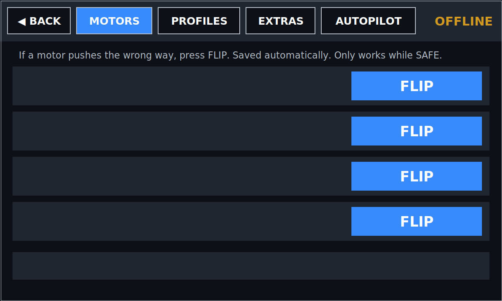

# ROV Backup: laptop + Arduino Mega

A second, independent way to drive the ROV if the Raspberry Pi fails.
The **laptop (EndeavourOS)** reads the PS5/PS4 controller and runs the same dashboard, drive profiles and
camera page as the Pi. It sends motor commands over **USB** to an **Arduino Mega 2560**, and the Mega drives the
same 4 BTS7960 boards.

```
PS5 controller --Bluetooth/USB--> Laptop (rov.py + dashboard) --USB--> Arduino Mega --> 4x BTS7960 --> thrusters
```

## Screenshots

The dashboard with nothing plugged in (no Arduino, no controller), so everything reads OFFLINE.

| Main page | Profiles |
|---|---|
|  |  |

| Setup |
|---|
|  |

## Files
| File | What it is |
|---|---|
| `rov_mega/rov_mega.ino` | Mega firmware (upload once) |
| `rov.py` | motor program (controller → motors), same as the Pi's but outputs to the Mega |
| `rov_gui.py` | dashboard window: camera, profiles editor, motor flip, STOP |
| `config.toml` | Mega pins, motor jobs/flips (copied from the Pi) |
| `profiles.json` | drive profiles (copied from the Pi) |
| `setup.sh` | one-command install / update (see above) |
| `updater.py` | automatic updates from GitHub (used by the app) |
| `install.sh` · `upload-mega.sh` · `run.sh` | set up · flash the Mega · start |

## Wiring (Mega)

Move the BTS7960 **signal** wires from the Pi to the Mega. The battery/motor wires (B+, B−, M+, M−) stay the same.
**Never connect the boards to the Pi and the Mega at the same time.** Making a second set of jumper wires
lets you swap over in a minute.

| BTS7960 board | RPWM | LPWM |
|---|---|---|
| Motor 1 (rear up)  | pin 2  | pin 3  |
| Motor 2 (front up) | pin 5  | pin 6  |
| Motor 3 (right)    | pin 7  | pin 8  |
| Motor 4 (left)     | pin 11 | pin 12 |

- **R_EN + L_EN on all 4 boards → pin 22**, with a **10 kΩ resistor from pin 22 to GND**.
- **VCC on all 4 boards → Mega 5V.** **GND → Mega GND.**
- Leave R_IS / L_IS unconnected.
- The Mega is powered by the laptop's USB cable.

The Mega's built-in **"L" LED is on whenever the motors are enabled**.

## Install or update: one command
On the EndeavourOS laptop, connected to the internet (Wi-Fi is fine), open a terminal and run:
```bash
curl -fsSL https://raw.githubusercontent.com/codemastervy/underwater-rov-backup/main/setup.sh | bash
```
- **New laptop:** installs everything (Python libraries, Bluetooth, ffmpeg, arduino-cli), adds **ROV Backup** to the app
  menu, and uploads the firmware if the **Mega is plugged in**. Then **log out and back in once**.
- **Already installed:** downloads the latest version and keeps your `config.toml`, `profiles.json` and `camera.json`.
  If the Mega is plugged in and the firmware changed, it uploads the new firmware too.
- Close the ROV Backup app before running it. Nothing needs installing first, not even git.
- **After that you never need the command again:** the app checks GitHub for a new version when it opens and every
  30 minutes. When there is one, it shows **⬆ UPDATE READY**; tap it (or **SETUP › EXTRAS › UPDATE NOW**) while SAFE.
  It downloads, installs and reopens itself. Settings are kept. If the update has new **Mega firmware**, the
  update panel tells you: close the app, plug in the Mega and run `bash ~/underwater-rov-backup/upload-mega.sh`.

Then pair the controller in the laptop's Bluetooth settings (PS5: hold **CREATE + PS**), or plug it in with a USB cable.

## Driving

**Printable controller card:** [docs/controller-card.pdf](docs/controller-card.pdf) (A4 landscape, one page) to stick on the case.
Open **ROV Backup** from the app menu (or `bash run.sh`). The controls are the same as on the Pi:

| Button | Action |
|---|---|
| OPTIONS | arm (sticks centred) |
| CIRCLE / CREATE / PS | disarm |
| Sticks / triggers / D-pad | depends on the drive profile (SETUP > PROFILES) |
| TRIANGLE | next drive profile (while SAFE) |
| SQUARE | camera page on/off |
| R1 / L1 | speed up/down |

**Keyboard drive** (switch on in SETUP › EXTRAS): W/S forward/back, A/D turn, Space up, Shift down, R/F tilt,
**Enter = ARM**, **Esc = STOP**. If the window closes or freezes, the keys count as released (and with no controller the
motors disarm).

**Arm sound:** when armed, the motors play **an FPV-drone style arming sound (5 s)** (no
speaker: a tiny audio-frequency PWM makes the motors whistle). **Touch any control and it stops at once** so you can
drive. **SET TUNE** takes any RTTTL ringtone text (saved in `tune.txt`); **DEFAULT TUNE** goes back. On/off, volume and
TEST are in SETUP › EXTRAS. **This needs the updated firmware: run the setup command again with the Mega plugged in.**

**Autopilot** (SETUP › AUTOPILOT, mouse only, OFF at every start-up): trim, CRUISE, LINE following, colour TARGET
following (pick the colour by clicking the object: camera page › PICK), camera HEADING hold and timed MISSIONs.
Any stick/key movement or STOP takes over. Green status bar = working; flashing red **TAKE CONTROL NOW** = unsure
(it hovers, then switches off after 3 s). Same as the Pi version: see the Pi repo's README for details.

**Camera picture:** CAMERA › PICTURE adjusts gain (ISO), brightness, contrast, colour and warmth (saved).

`bash run.sh --fullscreen` for full screen, `--size 1600x960` for a bigger window.

**Camera:** plug the capture card into the laptop. It's picked automatically (the laptop's own webcam is skipped).
If the wrong camera shows, set `device = "/dev/video2"` (etc.) under `[camera]` in `config.toml`.

## Safety
- Won't arm until the Mega has answered ("⚠ Arduino Mega not found" is shown otherwise).
- **The Mega stops all motors by itself if the laptop goes quiet for 0.3 s**: app closed, laptop crash,
  USB unplugged.
- The laptop disarms if the Mega stops answering, the controller disconnects, or its Bluetooth link goes quiet.
- After any of these you must press OPTIONS again.

## Troubleshooting
- "No permission for /dev/ttyACM0": you didn't log out/in after `install.sh`.
- "No answer from /dev/ttyACM0": the firmware isn't uploaded. Run `upload-mega.sh`.
- Controller not seen: `python3 rov.py --list` lists input devices.
- Motor wrong way: SETUP > MOTORS > FLIP (saved in this laptop's `config.toml`, separate from the Pi).
